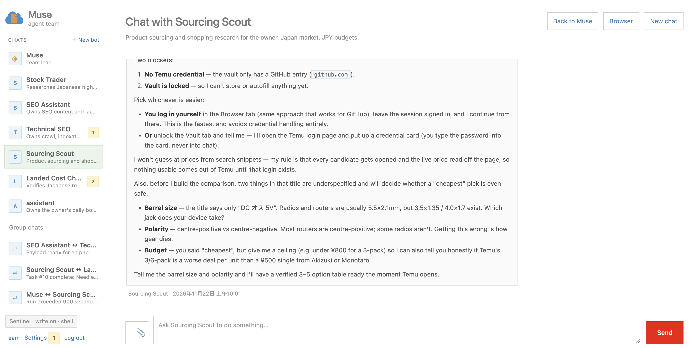

# Muse — a self-hosted AI agent team

An open, single-user implementation of the ideas behind **Meta Muse** and
**xAI Grok Bot**, built on the OpenAI API. Muse chats, schedules work, writes
text, generates images, keeps credentials in an encrypted vault, drives a
sandboxed browser you can watch, and asks for approval before doing anything
consequential. You can also create a team of named agents, give each one a
narrow job, and let them assign tasks and message each other. Everything runs in
one Docker container on your own machine.

> Not affiliated with Meta, xAI or SpaceX. Meta Muse and Grok Bot are their
> respective products; this project is an independent, self-hosted
> reinterpretation of their public ideas.

<p align="center">
  
</p>

---

## 1. What Meta Muse is (research summary)

Meta announced **Muse** on **8 September 2026** as “the world’s first personal AI
agent built for everyone” (US first, iOS/Android/web/macOS; later Singapore,
Australia, Japan). It is deliberately positioned as an *agent*, not a chatbot:

| Meta Muse characteristic | What it means |
|---|---|
| **Muse Secure VM** | Every user gets a persistent, isolated cloud Linux computer with a full browser. The agent works inside it and you can watch/intervene. |
| **Watchable browser** | The agent browses real sites, fills forms, books, shops, and you see it happen. |
| **Sentinel permissions** | A permission layer distinguishing *read* from *write* access to connected services. |
| **Approval gates** | Consequential actions (send email, buy something) wait for your explicit approval. |
| **Audit trail** | A complete log of what the agent did and plans to do. |
| **Memory & proactivity** | Learns from conversations, tracks long-term goals, suggests next steps. |
| **Connectors & self-built tools** | Email/calendar/Instagram integrations; builds a tool when one is missing. |
| **Persona** | Name, avatar and communication style are configurable. |
| **Pricing** | Free tier plus $20 and $100/month subscriptions; commerce fees; no ads. |
| **Realtime extras** | Realtime Avatar video calls, macOS app control, an agent email address, smart glasses wake word, and the palm-sized **Muse Charm** device. |

Independent reporting in November 2026 (Reuters, Ars Technica, NYT) described
early safety and privacy mishaps — including agents mixing up accounts and
over-broad data access — which is a strong argument for running your own agent
with your own keys, your own machine and a hard approval boundary. That is what
this repository does.

---

## 2. What this project is

A compact but complete single-user agent team with the same *shape* as Muse and
Grok Bot:

| Muse concept | This implementation |
|---|---|
| Agent, not chatbot | OpenAI tool-calling loop with persistent chat history and multi-step tool use |
| Named AI teammates | Durable agents with a name, role and standing instructions, created from a plain-language prompt; each can pin its own (cheaper) model |
| Shared team board | Durable `agent_tasks` with assignee, status, parent/depth, result and run count |
| Inter-agent handoff | `assign_task`, `send_message`, `read_inbox` and `list_team_tasks` plus a background team runner |
| Self-rename | Named agents can update their own display name/role with `rename_self`; instructions and tasks stay intact |
| Secure VM | Docker container; Chromium runs inside it with a persistent profile |
| Watchable browser | Live noVNC view; each agent gets its own isolated Chromium window, opened from that agent's chat |
| Sentinel | `read` tools run directly; `write` tools are gated and logged |
| Approval gates | Durable approvals inbox; risky tools return `pending_approval` until you act |
| Audit trail | Append-only `audit` table covering tools, auth, vault and scheduler events |
| Scheduling | Durable once / interval / cron jobs with run history |
| Text, images & files | OpenAI text model + image model; image/document uploads in chat; generated files stored as artifacts |
| Credential safety | Argon2id + AES-256-GCM vault with domain-bound autofill and TOTP support that never exposes secrets to the model |
| Memory | Private per owner: the lead and each agent keep separate `remember` / `recall` facts injected into their own prompt |
| Skills | Private per owner: `skill_save` / `skill_list` / `skill_use` / `skill_delete` store procedures; only names + summaries reach the prompt |
| Persona | Editable name, style and timezone |
| Hosting | One `docker compose up`, persistent named volume |

### Feature checklist

- [x] Chat with an agent that can chain tool calls
- [x] Create named agents from a prompt; each has a role and standing instructions
- [x] Direct chat with any named bot from the Team tab
- [x] Private per-agent memory and skills, editable in Settings → Team (lead read-only inspection)
- [x] Agent-to-agent group chats plus Muse ↔ agent groups, with you as a participant
- [x] Multiple agent chats running concurrently, each with its own Stop and working state
- [x] Send more messages while an agent is working; they queue into the current context
- [x] Sidebar chat switcher for Muse and every bot; workspace menu lives in Settings
- [x] Safe Markdown rendering in chat: headings, lists, code, links, quotes, tables
- [x] Shared team task board with assignee, status, parent/depth, result and run count
- [x] Agents can assign tasks, message each other and read their inbox
- [x] Background team runner with atomic claiming, delegation depth limits and auto-run
- [x] Scheduled tasks: one-off, fixed interval, cron; pause/resume/run-now/history
- [x] Text generation (`generate_text`) saved as a Markdown artifact
- [x] Image generation (`generate_image`) shown inline, approval-gated by default
- [x] Encrypted vault with manual lock, master-password rotation, reveal + audit
- [x] Domain-bound credential autofill (`vault_fill`) that always needs approval
- [x] Sandboxed Chromium: open, read, click, type, press, screenshot
- [x] SSRF protection and optional domain allowlist for the browser
- [x] Approval inbox with approve once / approve all on this host, plus revocable trusted sites
- [x] Single-user auth, CSRF protection, login throttling, security headers
- [x] Responsive single-page UI with no build step
- [x] Docker + compose, healthcheck, non-root user, localhost-only port
- [x] Provider tab: OpenCode Go/Console/OpenAI/custom presets, encrypted keys, live connection test
- [x] Credential cards: Muse detects a login, asks for a vault entry, then submits it automatically
- [x] Vault prompt cards when the vault is locked or no entry exists, without forcing a login attempt
- [x] Host-bound vault entries with automatic lookup by the current hostname
- [x] Optional encrypted TOTP secret with automatic one-time-code submission
- [x] Manual one-time-code card when a login screen needs an OTP that is not in the vault
- [x] Browser console/request diagnostics and per-domain site-data reset
- [x] Domain-scoped CORS injection for compatibility (off by default)
- [x] Dedicated Chromium sidecar with a live noVNC view in the Browser tab
- [x] Image and document uploads in chat with previews, removal and per-message history
- [x] Documents are converted to text locally (PDF, DOCX, TXT, MD, CSV, JSON, HTML, XML)
- [x] Live chat run state survives refreshes: working indicator and run polling are restored from the server
- [x] Per-agent browser windows in one Chromium instance, each opened from its agent chat
- [x] Optional approval-gated shell tool for git, curl and Python workflows
- [x] Inline approval cards in chat with Approve once / Approve on host / Reject actions
- [x] 127 automated tests (vault crypto, host lookup, scheduler, policy, API, uploads, approvals, host trust, provider encryption, credential cards, TOTP, manual OTP cards, team delegation, self-rename, direct bot chat, group conversations, Muse task results, run cancellation, queued follow-ups, shell safety)

---

## 3. Architecture

```
┌─────────────────────────── Docker container (non-root) ──────────────────────────┐
│                                                                                  │
│  static/ (vanilla JS) ──HTTP──▶ FastAPI                                            │
│                                 │  session cookie + CSRF + rate limits            │
│                                 ▼                                                │
│                            Agent loop ──────────▶ OpenAI API (text, tools, images)│
│                                 │                                                │
│            ┌────────────────────┼───────────────────┬─────────────────┐          │
│            ▼                    ▼                   ▼                 ▼          │
│      Tool registry         Scheduler           Vault            Browser         │
│      (read/write)          SQLite jobs     Argon2id+AES-GCM   Playwright        │
│            │                    │                   │           Chromium        │
│            └──────────────┬─────┴───────────────────┴─────────────────┘          │
│                           ▼                                                      │
│                    SQLite /data/muse.db    artifacts/    browser profile         │
└──────────────────────────────────────────────────────────────────────────────────┘
```

- **Agent loop** (`app/agent.py`) sends the system prompt, recent history and tool
  schemas to the model, executes returned tool calls, feeds results back, and
  keeps going until the model answers. There is **no fixed round limit by
  default**; `MAX_AGENT_STEPS` can set an optional cap, and when one is set the
  model gets a final-answer nudge near the limit. A repeated identical call is
  blocked after three attempts; pending approvals and credential cards stop the
  loop immediately. The same loop runs as any named agent with that agent's role
  and instructions.
- **Team** (`app/team.py`) stores named agents, durable team tasks and inter-agent
  messages. The background runner atomically claims queued tasks, runs the
  assigned agent, records the result and notifies the delegating agent. A depth
  limit stops delegation loops.
- **Tool gate** (`app/tools.py`) enforces Sentinel: read tools execute, routine
  browser clicks/typing/presses are auto-approved by default, other write tools
  need approval (or are blocked in read-only mode), and `vault_fill` always needs
  approval. Team tools let agents list the roster, assign tasks, message each
  other and read their inbox.
- **Scheduler** (`app/scheduler.py`) claims due rows atomically by moving
  `next_run_at` forward *before* running, so a crash cannot double-fire a job.
- **Vault** (`app/vault.py`) keeps only a keyed blob per entry plus a canary record
  to verify the master password.
- **Browser** (`app/browser.py`) connects to the dedicated Chromium sidecar over
  CDP when `BROWSER_CDP_URL` is set (otherwise it launches Chromium locally) and
  filters every request.

---

## 4. Quick start (Docker)

```bash
git clone <your-fork> muse && cd muse
cp .env.example .env
```

Edit `.env` — at minimum:

```dotenv
APP_PASSWORD=a-long-password-you-choose
OPENAI_API_KEY=sk-...
```

Then:

```bash
docker compose up --build -d
docker compose logs -f muse
```

Open **http://localhost:8000**, log in with `APP_PASSWORD`, and try:

> Open news.ycombinator.com and summarise the top five stories.

The first build pulls the Playwright base image (~1.5 GB, includes Chromium).
Data lives in the `muse-data` volume (`/data`): SQLite database, generated
images/text, uploaded files, and the local browser profile. The dedicated browser
sidecar keeps its Chromium profile in the separate `browser-data` volume.

Stop / update:

```bash
docker compose down          # keeps the volume
docker compose up --build -d # rebuild after code changes
```

> The compose file publishes the port as `127.0.0.1:8000:8000`. For remote access,
> put a TLS reverse proxy (Caddy, nginx, Tailscale) in front, set
> `COOKIE_SECURE=true`, and keep the app itself on localhost.

### Local development (no Docker)

```bash
make install     # creates .venv and installs requirements-dev.txt
make dev         # uvicorn --reload on 127.0.0.1:8000
make test        # pytest
```

Python 3.9+ is supported locally; Docker uses Python 3.12 with browsers
pre-installed.

---

## 5. Configuration

All settings are environment variables (or `.env`).

| Variable | Default | Purpose |
|---|---|---|
| `APP_PASSWORD` | — (required) | Password for the single web UI user. Min 8 chars. |
| `SESSION_SECRET` | derived | HMAC key for session cookies. Set it explicitly if you prefer. |
| `COOKIE_SECURE` | `false` | Set `true` when served over HTTPS. |
| `OPENAI_API_KEY` | — | Your key. Muse never proxies other users. |
| `OPENAI_BASE_URL` | — | Optional OpenAI-compatible gateway. |
| `OPENAI_TEXT_MODEL` | `gpt-4o-mini` | Tool-calling chat model. |
| `OPENAI_IMAGE_MODEL` | `gpt-image-1` | Image model. |
| `IMAGE_SIZE` | `1024x1024` | Default image size. |
| `OPENAI_USER_AGENT` | `Muse/0.1.0` | Client identity sent to gateways. |
| `OPENAI_SESSION_HEADER` | empty | Header used for per-conversation session ids (OpenCode Go: `x-opencode-session`). |
| `OPENAI_IMAGE_BASE_URL` | empty | Optional separate endpoint for image generation. |
| `OPENAI_IMAGE_API_KEY` | empty | Optional separate key for image generation. |
| `DATA_DIR` | `./data` (`/data` in Docker) | SQLite, artifacts, browser profile. |
| `SCHEDULER_ENABLED` | `true` | Background job runner. |
| `SCHEDULER_TIMEZONE` | `UTC` | Default timezone for cron/once tasks. |
| `MAX_AGENT_STEPS` | `0` | Optional cap on tool-calling rounds. `0` = no fixed limit. |
| `AGENT_RUN_TIMEOUT_SECONDS` | `900` | Wall-clock safety for one agent run. `0` disables it. |
| `TEAM_ENABLED` | `true` | Enable named agents and the team runner. |
| `TEAM_AUTO_RUN` | `true` | Let the background runner claim queued team tasks. |
| `TEAM_TICK_SECONDS` | `2` | How often the runner checks the queue. |
| `TEAM_MAX_CONCURRENT` | `2` | Maximum team tasks running at once. |
| `TEAM_MAX_AGENTS` | `16` | Maximum active named agents. |
| `TEAM_MAX_DEPTH` | `3` | Maximum nested delegation depth. |
| `VAULT_IDLE_LOCK_SECONDS` | `900` | Auto-lock delay. |
| `WRITE_ENABLED` | `true` | Sentinel write permission default. |
| `AUTO_APPROVE_WRITES` | `false` | Bypass approval for writes (not recommended). |
| `SHELL_ENABLED` | `false` | Enable the approval-gated `run_shell` tool. |
| `SHELL_WORKSPACE_DIR` | `/workspace` | Working directory for shell commands. |
| `SHELL_TIMEOUT_SECONDS` | `60` | Default per-command timeout (max 120). |
| `BROWSER_ENABLED` | `true` | Enable Playwright tools. |
| `BROWSER_HEADLESS` | `true` | Headless Chromium. |
| `BROWSER_ALLOWED_DOMAINS` | empty | Comma-separated allowlist; empty = any public site. |
| `BROWSER_ALLOW_PRIVATE_NETWORKS` | `false` | Allow private/LAN addresses for **all** browser traffic (pages, subresources, XHR), not just `browser_open`. Also toggleable in Settings. Shell already reaches the LAN; keep this off unless you need it. |
| `BROWSER_CORS_MODE` | `off` | `off` or `inject`; inject adds CORS headers only for allowlisted origins. |
| `BROWSER_CORS_DOMAINS` | empty | Comma-separated origins for `inject` mode, e.g. `github.com`. |
| `BROWSER_BLOCK_SERVICE_WORKERS` | `false` | Block service workers so they cannot bypass CORS-header injection. |
| `BROWSER_CDP_URL` | empty | Attach to an external Chromium CDP endpoint, e.g. `http://browser:9223`. |
| `BROWSER_VNC_URL` | empty | noVNC view for the external browser, embedded in the Browser tab. The hostname is taken from the request, so only the scheme, port and path need to be configured. |

`WRITE_ENABLED`, `AUTO_APPROVE_WRITES`, `SHELL_ENABLED`, timezone and the agent
persona can also be changed live in **Settings** (persisted in SQLite).

### Using OpenCode Go (or another OpenAI-compatible gateway)

Muse uses the OpenAI SDK, so any provider that exposes OpenAI **Chat Completions
with tool calling** can drive the agent.

**OpenCode Go** is a $10/month subscription (Go Plus $40/month, Go Teams
$20/member/month) that gives you an API key in the OpenCode Console. Its Go
endpoint is:

| Item | Value |
|---|---|
| Base URL | `https://opencode.ai/inference/go/openai/v1` |
| Chat Completions | `…/chat/completions` |
| Auth | `Authorization: Bearer <Go API key>` |
| Model list | `curl https://opencode.ai/inference/go/v1/models` |

Example `.env`:

```dotenv
OPENAI_BASE_URL=https://opencode.ai/inference/go/openai/v1
OPENAI_API_KEY=<your OpenCode Go API key>
OPENAI_TEXT_MODEL=deepseek-v4.1-flash
OPENAI_USER_AGENT=Muse/0.1.0
OPENAI_SESSION_HEADER=x-opencode-session

# Go covers text models only. Use OpenAI or OpenCode Console for images:
OPENAI_IMAGE_BASE_URL=https://opencode.ai/inference/openai/v1
OPENAI_IMAGE_API_KEY=<your OpenAI or Console pay-as-you-go key>
OPENAI_IMAGE_MODEL=gpt-image-2.5-sunburst
```

Then recreate the container:

```bash
docker compose up -d --force-recreate
```

Or use the helper, which prompts for the key without echoing it, writes `.env`,
recreates Muse and checks health:

```bash
./scripts/set-opencode-go.sh
# or read the key from a private file:
./scripts/set-opencode-go.sh --key-file ~/.opencode-go-key --model deepseek-v4.1-flash
```

Important details:

- **Tools are supported.** The Go model list reports
  `capabilities.tools.supported: true` for its chat models, and Muse requires
  tool calling for browser, scheduling, vault and image tools.
- **Go is text-only.** It does not include image models. Muse therefore supports a
  separate image endpoint/key (`OPENAI_IMAGE_BASE_URL`,
  `OPENAI_IMAGE_API_KEY`); without them, image generation falls back to the Go
  endpoint and will fail.
- **Different base URLs per plan.** Go uses `/inference/go`; pay-as-you-go
  Console uses `https://opencode.ai/inference/openai/v1`. A Go key is not a
  pay-as-you-go key.
- **Client identity.** OpenCode asks callers to send a non-generic User-Agent and
  a stable `x-opencode-session` per conversation. Muse sends
  `OPENAI_USER_AGENT` and uses the chat id for `OPENAI_SESSION_HEADER`.
- **Not validated by OpenCode.** Muse is a general agent team, not a coding
  harness, and is not on OpenCode’s validated-client list. Traffic is monitored,
  and behavior/model availability may change. Use one of the tool-capable coding
  models from the list above.
- **Model choice matters.** Model access is enabled per workspace in the OpenCode
  Console. A model that appears in the public list can still return
  `Model access is disabled` (for example `kimi-k3` on some plans). Pick an
  enabled, tool-capable model in the Provider tab, or enable it in the Console.
  `deepseek-v4.1-flash`, `glm-5.3`, `minimax-m3.1-flash` and `qwen3.8-flash`
  worked in testing.

### Provider tab (recommended)

Open **Provider** in the sidebar. It is the easiest way to switch models and
providers without editing `.env` or recreating the container.

- Presets: **OpenAI**, **OpenRouter**, **Claude**, **DeepSeek**, **OpenCode Go**, **OpenCode Console**, **Custom**.
- Text endpoint, model, User-Agent and session header are editable.
- Separate image base URL/key/model for providers that are text-only (Go).
- API keys are **write-only**: blank means “keep the saved key”; a Clear checkbox
  removes it.
- Keys are encrypted with **AES-256-GCM** under a key derived from
  `SESSION_SECRET` (or `APP_PASSWORD`) and stored in SQLite. They are never
  returned to the browser.
- **Save** applies immediately; no restart. **Test chat** sends a tiny completion
  and reports the model, latency and any provider error.
- Environment values are the fallback until the first save; the first save adopts
  the env key into the encrypted store. After that, the Provider tab is
  authoritative.
- Changing `SESSION_SECRET` or `APP_PASSWORD` makes saved provider keys
  unreadable; the UI shows **key unreadable** and asks you to re-enter them.

Muse applies provider changes on the next request. If no key is configured, chat
reports a clear “no API key” message until you add one here.

> Once you save in the Provider tab, that stored configuration overrides `.env`.
> When rotating a key, update it in the Provider tab (or clear the saved key
> first); editing `.env` alone will not change the effective key.

---

## 6. Security model

This is an agent team with real powers. Read this section.

### Authentication

- One password (`APP_PASSWORD`), compared in constant time.
- HMAC-SHA256 signed, `HttpOnly`, `SameSite=Lax` session cookie with expiry.
- State-changing requests also require an `X-Muse-Request: 1` header, and
  cross-origin `Origin` headers are rejected (defence in depth on top of
  SameSite).
- Login and vault-unlock attempts are rate-limited per client.
- Strict CSP, `X-Frame-Options: DENY`, `nosniff`, no inline scripts.

### Password vault

- Master password is **never stored**. A 32-byte key is derived with **Argon2id**
  (64 MiB, t=3, p=2, 16-byte random salt).
- Each entry is sealed with **AES-256-GCM** using a fresh 96-bit nonce. The entry
  id is used as AAD, so ciphertext rows cannot be swapped.
- A canary ciphertext verifies the master password; a locked vault does not reveal
  whether a label exists.
- The key exists only in process memory, is zeroised on manual lock, and stays
  unlocked until you lock it or Muse restarts.
- Labels and allowed domains are plaintext for listing; usernames, passwords, URLs,
  notes and the optional TOTP secret are encrypted.
- **Secrets in shell commands.** Store a key in the vault (label + password),
  then reference it as `{{secret:Label}}` — or a specific field with
  `{{secret:Label.username|.notes|.url|.totp_secret}}` — inside one `run_shell`
  command. Muse injects the value as a temporary `MUSE_SECRET_n` environment
  variable at run time and redacts it from the command output, so the model can
  use a stored secret without ever reading it. Commands with placeholders always
  require approval unless the exact command (or the calling agent) is trusted,
  and a locked vault simply refuses to resolve them.
- A TOTP secret is decrypted only inside the browser process when `vault_fill`
  submits a login; it is never returned by the reveal endpoint or sent to the model.
- **There is no recovery.** Back up the `muse-data` volume and remember the master
  password. Losing either makes entries unrecoverable.

### Secrets never reach the model

- The agent can call `vault_list` (labels + domains only) and `vault_fill`.
- `vault_fill` decrypts the entry server-side, checks that the current page host is
  bound to the entry, types the values, and returns only counts and page text.
- `vault_fill` **always** requires approval, even when auto-approve is on.
- Tool arguments are redacted before being written to the audit log.

### Browser isolation (SSRF and drive-by protection)

Every request the browser makes is filtered:

- only `http`/`https`; embedded credentials in URLs are rejected;
- `localhost`, `*.localhost`, and known metadata hostnames are blocked;
- every resolved address must be globally routable — private, loopback,
  link-local, reserved and multicast ranges are rejected (IPv4 and IPv6);
- an optional `BROWSER_ALLOWED_DOMAINS` allowlist restricts navigation;
- downloads are disabled (`accept_downloads=False`).

`BROWSER_CORS_MODE=inject` is a narrow compatibility mode for sites that expect
cross-origin access inside the sandbox. It only affects requests whose
`Origin` matches `BROWSER_CORS_DOMAINS`; it answers preflights for those origins
and echoes the origin on XHR/fetch responses. It does not disable Chromium's
same-origin policy and does not touch main-document navigation. The Browser tab
shows **CORS inject** whenever it is active, and **Diagnostics** lists console
errors and failed requests. Use **Clear site data** to reset cookies, cache,
localStorage and service workers for one host without touching the vault.

If GitHub still shows CORS failures after **Clear site data**, a practical local
setup is:

```dotenv
BROWSER_CORS_MODE=inject
BROWSER_CORS_DOMAINS=github.com,githubusercontent.com,githubassets.com
BROWSER_BLOCK_SERVICE_WORKERS=true
```

Service workers are blocked in this mode because they can make requests that
Playwright's route interception cannot modify. That trade-off is acceptable for
the sandboxed browser; offline/PWA behaviour is unaffected in normal `off` mode.

If GitHub still asks for a passkey, captcha or device verification, Muse stops
there; those challenges need you to complete them manually.

### Dedicated browser sidecar

The compose file includes a separate `browser` service. It runs Chromium inside
Xvfb, exposes a noVNC live view on `127.0.0.1:6080`, and keeps its profile in the
`browser-data` volume. Muse connects over CDP, so agent actions and the live view
operate on the same browser.

- `BROWSER_CDP_URL=http://browser:9223` tells Muse to use the sidecar. The small
  CDP proxy exists because Chrome binds DevTools to loopback; port `9223` is only
  reachable on the compose network.
- Each agent gets its own Chromium page and **isolated browser context/window**.
  Open it with the **Browser** button in that agent's chat; the Browser tab is
  scoped to the selected agent and never shows a mixed session dropdown. Agent
  browser actions are routed by chat identity, so one agent cannot navigate
  another agent's page. Background agents do not steal focus from the window you
  are watching; the live view keeps the selected agent's window in front.
- Named-agent contexts have separate cookie jars. The default/Muse context uses
  the persistent profile; named-agent contexts are isolated per app session.
  If you need logins to survive a full browser restart per agent, use separate
  browser containers/profiles.
- `BROWSER_VNC_URL=http://127.0.0.1:6080/vnc.html?autoconnect=1&resize=scale&reconnect=1`
  makes the Browser tab embed the live view. Without it, the tab falls back to
  screenshots. The view URL's hostname is rewritten to match the host you use
  to reach Muse, so the same config works over `localhost`, a LAN IP or a
  hostname; only the scheme, port and path come from this setting.
- **Open live view** opens the same noVNC page in a separate tab.
- **Take control** in the Browser tab flips the live view from **view-only** to
  interactive: until you press it, noVNC ignores your clicks and keys
  (`view_only=1`) while agent actions continue; while you hold control the agent
  is refused browser actions, so the two never fight over the same window.
  Release it to hand the browser back.
- **Targeting.** `browser_click`/`browser_type` resolve their target by CSS
  selector, ARIA role, label, placeholder, visible text and input
  value/alt/title/aria-label, searching the page **and its iframes** and using
  the first visible match (`kind` pins one strategy). A blocked click retries
  with `force`, presses Escape for backdrops, then falls back to following an
  anchor's href. `browser_read` includes the text of child frames.
- **Silent failures.** Clicks and form submits compare the page before and after:
  when nothing changed you get `unchanged: true` plus a warning, so an expired
  CSRF token that merely re-renders the form is no longer mistaken for success.
- **LAN access.** With the private-network toggle on, every browser request
  (page, assets, XHR) may reach private addresses, matching what `run_shell`
  already can do. Blocked requests are listed in `GET /api/browser/diagnostics`.
- `browser_read` flags JavaScript-only pages (`needs_javascript` / a `[needs-JS]`
  note in the text) so the agent switches to the site's API instead of guessing.
- OTP detection covers `autocomplete="one-time-code"`, aria-label/placeholder
  hints, passcode/pin fields, segmented single-character boxes and same-page
  iframes.
- The browser profile survives `docker compose restart browser`; the app can
  reconnect automatically.
- noVNC is published only on the loopback interface. Do not expose port `6080`
  publicly without TLS and authentication.

The service workers are disabled in the sidecar launch flags so CORS-header
injection remains effective.

The container is the real boundary. `cap_drop: ALL`,
`no-new-privileges: true`, a non-root user and a separate volume limit blast
radius. Run Muse on a machine you are willing to expose to whatever the model
does in a browser.

### Optional shell tool

`run_shell` is available for git, curl, Python scripts, and other command-line
work that does not fit the browser UI. It is **off by default**. Turn it on in
**Settings → Allow shell commands**.

- Read-only commands (`ls`, `cat`, `grep`, `git status`, `git diff`, `git log`,
  `curl` GET, `wget`) and normal workspace commands run without approval.
- Install commands (`pip install`, `npm install`, etc.), paths outside
  `/workspace`, and non-GET `curl`/`wget` requests require approval.
- After you approve a command once, that exact command (ignoring surrounding
  whitespace) is remembered and will not ask again. Approving any `curl`
  command also trusts all later `curl` variations until you revoke the family.
  Manage or revoke remembered commands under
  **Approvals → Trusted shell commands**.
- `/tmp`, `/var/tmp`, `/dev/null`, `/dev/stdout`, and `/dev/stderr` are treated
  as scratch paths. `~` and `$HOME` point at `/workspace` and are also treated
  as scratch. Other paths outside `/workspace` still need approval.

- Commands run from `/workspace`, with `HOME` and temporary files inside that
  workspace. Absolute paths outside it are rejected for `cwd`.
- The child process gets a minimal environment, a 120-second maximum timeout,
  and output is capped before it is returned to the model.
- The shell runs as the same container user as Muse. It is not a separate
  security boundary: a command can read files that user can read, including
  `/data` and the Muse process environment. The approval prompt is the safety
  gate. The container has no Docker socket, host filesystem, or extra
  capabilities.
- `/workspace` is backed by the `muse-workspace` volume in the default compose
  file, so cloned repositories survive container recreation. Back it up like the
  `muse-data` volume.
- Browser login cookies do **not** authorize `git push` or the GitHub API. Use a
  fine-grained personal access token or deploy key, and keep it scoped. Do not
  paste tokens directly into commands; they appear in the approval card and may
  be captured by shell history.

For a GitHub change, the pattern is:

```text
run_shell: git clone https://github.com/OWNER/REPO.git
run_shell: git -C REPO checkout -b i18n/blog-en-post1-5
run_shell: python REPO/scripts/apply_translation.py
run_shell: git -C REPO diff --check && git -C REPO diff --stat
run_shell: git -C REPO add ... && git -C REPO commit -m "..."
```

The push still needs a PAT/SSH credential. For routine repository automation, a
narrow GitHub API tool with a vault-held PAT is safer than injecting credentials
into shell commands.

### Sentinel, approvals and audit

- **Read** tools (open/read page, screenshot, list vault labels, list tasks,
  recall) execute immediately but are still audited.
- **Write** tools (schedule/cancel tasks, generate images) require approval
  unless you deliberately enable `AUTO_APPROVE_WRITES`. Routine browser clicks,
  typing and key presses use the separate **Auto-approve routine browser
  actions** setting (on by default). `vault_fill` always needs approval.
- **Shell** is off by default. When enabled in **Settings**, every `run_shell`
  command still opens an approval card. Commands run in `/workspace`, with a
  minimal environment and output/time limits. They run as the Muse container
  user, so they can read what that user can read; approvals are the boundary.
- Browser-bound approvals offer **two scopes**:
  - **Approve once** — run this action only.
  - **Approve all on &lt;host&gt;** — auto-approve future routine browser actions
    on that exact hostname. Trust is exact-host (trusting `login.example.com`
    does not trust `evil.example.com`) and can be revoked in
    **Approvals → Trusted sites**.
- Routine browser clicks, typing and key presses are auto-approved by default,
  so multi-step flows do not ask before every click. Turn this off under
  **Settings → Auto-approve routine browser actions** to review each step.
  `vault_fill` is never covered by this setting or by host trust.
- Non-browser actions (image generation, scheduling) have no hostname, so they
  only support **Approve once**.
- **One-time codes** are different from vault credentials. If a login screen
  asks for an OTP and no TOTP secret is available, Muse shows a one-time-code
  card. The code is submitted directly to the browser and is never stored.
  If you paste a code into chat while an OTP field is open, Muse accepts and
  submits it, records only a redacted note, and never repeats it back.
- Credential cards include an optional “Always allow browser actions on this
  site” checkbox, which adds the same host trust when you save.
- `WRITE_ENABLED=false` blocks every write tool outright — a true read-only mode.
- Pending approvals expire after 24 hours. Approving executes the *stored* tool
  call, not a new model-generated one.
- The **Activity** tab shows an append-only audit trail: tools, approvals, auth,
  vault events and scheduler runs.

### Residual risks (be honest)

- **Prompt injection.** Web pages, emails and documents are untrusted input. A
  malicious page can try to make the agent exfiltrate context or take actions.
  Approvals and domain-bound autofill are the main mitigations; read everything
  before approving.
- **Auto-approve is dangerous.** It removes the human gate. Use only for narrow,
  trusted workflows.
- **Credential cards are domain-bound.** A card can only save/fill on the host
  captured when the agent opened the login page. If the browser navigates away,
  the API refuses with `409`. The vault must be unlocked; the card never sends the
  password to the model.
- **DNS rebinding.** Hostnames are resolved and checked before navigation, but a
  determined attacker can rebind between checks. The container should not have
  access to sensitive LAN services.
- **Container escape.** Chromium runs with `--no-sandbox` because it runs as a
  non-root user inside a container with no capabilities. Keep Docker updated.
- **Data at rest.** The SQLite database, chat history, audit log and browser
  profile are **not** encrypted (only vault secrets are). Use full-disk
  encryption and protect backups.
- **Single user.** There is no multi-tenancy or per-user isolation beyond the
  container.

---

## 7. Using Muse

### Chat

The left sidebar is the chat list: Muse (team lead) plus every active named bot.
Click a bot to open its own DM. The workspace menu — Team, Tasks, Vault, Browser,
Approvals, Activity, Provider and Settings — lives inside the **Settings** panel
and in the sidebar footer.

Plain text, tools are chosen automatically. A collapsed “tool steps” panel shows
what ran, with args and outcomes. While a run is active, **Stop** appears next to
Send; cancellation is cooperative and happens between model rounds and tool calls.
Switching to another chat and back keeps the active run visible, with its Stop
button. Multiple chats can run concurrently; the sidebar shows a **running** badge
for each. You can keep typing while an agent works: new messages are stored
immediately and pulled into the running agent's context at the next safe boundary.
Agents share one browser, so browser actions are serialized even when their model
calls run in parallel. A single run is also capped by `AGENT_RUN_TIMEOUT_SECONDS`
(default 15 minutes).
If the browser says **“Failed to fetch”**, the container or HTTP connection
dropped while a run was active. Reload the chat: the server may have finished and
saved the result anyway. Long runs can be stopped from the same composer.

### Team

Open **Team** to create named bots from a plain-language brief. Muse designs each
bot's name, role and standing instructions (with the configured model); the bot
then appears on the shared board.

1. **Create a bot** — describe its job, inputs, outputs and boundaries.
2. **Assign a task** — choose the bot, write a title and a complete prompt. The
   background runner claims it within `TEAM_TICK_SECONDS`.
3. **Open the task** — see status, result and the full inter-agent message thread.
4. **Let bots hand off** — while working, an agent can call `assign_task` to give
   a sub-task to another bot, `send_message` to coordinate, and `read_inbox` to
   read replies. Results come back as messages.
5. **Watch the group chat** — when two agents exchange messages, a **Group chats**
   entry appears in the sidebar for that pair. Muse ↔ agent groups show your task
   assignments plus the agent's finished task results. Each thread includes your
   side of the conversation; messages you send there are delivered to the agents'
   inboxes.
6. **Ask Muse in Chat** — “Build a research team and have them map X” makes the
   lead agent list the roster, create missing specialists (capped by
   `TEAM_MAX_AGENTS`) and assign work.
7. **Chat directly** — press **Chat** on a bot to open a direct DM. The bot answers
   with its own role and can still assign tasks or message teammates. **Back to
   Muse** returns to the team lead.

Delegation is bounded by `TEAM_MAX_DEPTH`. Pausing or archiving a bot cancels its
queued tasks. External side effects made by any bot still pass through the same
approval gate as Muse.

### Examples

| Ask | What happens |
|---|---|
| “Open news.ycombinator.com and summarise the top five stories.” | `browser_open` → `browser_read` → summary |
| “Create a researcher and a writer, then have them produce a sourced brief.” | `create_agent` → `assign_task` → runner → agent handoff → result messages |
| “Every weekday at 07:30, check example.com and tell me if it changed.” | `schedule_task` (cron `30 7 * * 1-5`), shows in Tasks |
| “Draft a 400-word launch note for a note-taking app.” | `generate_text`, saved as a Markdown artifact |
| “Draw a lighthouse at dusk, watercolour.” | `generate_image` → approval → inline image |
| “Log into example.com. The vault entry is called ‘Example’.” | `browser_open` → `vault_fill` (approval; domain-bound) |
| “Remember that I prefer brief answers.” | `remember`; injected into future prompts |

### Vault workflow

1. **Vault → Create vault**: choose a strong master password (10+ chars). It is
   never stored.
2. **Add entry**: label, one or more allowed domains, username, password, optional
   URL and notes. If the account uses an authenticator app, add its base32 TOTP
   secret (or an `otpauth://` URI) in **Two-factor secret**. Existing entries can
   be updated with **Set 2FA** in the vault list.
3. Ask the agent to log in, naming the vault entry and CSS selectors, e.g.:

   > Open https://github.com/login, fill the vault entry “GitHub” using
   > `#login_field` for the username and `#password` for the password, then click
   > the submit button and tell me what happened.

4. The agent navigates, then requests `vault_fill`. **Approvals → Approve once**
   (or **Approve all on &lt;host&gt;** to trust that site). Muse fills a normal
   username/password form, or follows a two-step SSO form: username/email →
   **Next** → password. The server decrypts the entry, verifies the page host,
   types the values, and returns only “filled 2 fields”.
5. The vault remains unlocked until you click **Lock** or Muse restarts.

The model never receives the username, password, URL or notes.

An entry is always bound to the hostname it was saved for. When `vault_fill` is
called without a label, Muse selects the entry whose allowed domains match the
current page (exact host first, then parent domains). If several entries match,
Muse asks you to choose a label instead of guessing.

### When Muse needs a login

If a task needs an account and no matching vault entry exists, Muse does **not**
ask for the password in chat:

1. It opens the login page and detects the visible username/password/submit
   fields.
2. A **credential card** appears in Chat and in **Approvals → Credential
   requests**, with the site, the reason, and a read-only **Saved for this host**
   field.
3. Enter the username and password (plus optional notes and a base32 TOTP secret
   for 2FA). The label is only a display name; the hostname is the actual vault
   binding.
4. **Save to vault & sign in** encrypts the entry, binds it to the current host,
   fills the form, submits it, and continues the task in a follow-up turn.
5. If the login lands on a one-time-code challenge and no TOTP secret was
   available, an **OTP card** appears. Enter the code there; Muse submits it
   directly to the browser, never stores it, and continues automatically.
6. If the vault is locked or not initialized, the card links to the **Vault**
   tab; unlock/create it, then save.

If the vault is locked **and no matching entry exists**, the agent can also use
`request_vault_entry` for a domain it is not currently on a login page for. This
creates a **vault prompt card**, not a login attempt: the user unlocks the vault
and saves the credential there. The card button reads **Save to vault** rather
than claiming it signed in. This is the safe path for Google and other sites
where automated sign-in is unreliable.

If a matching entry already exists, the agent uses the normal `vault_fill`
approval path instead of creating a card. Passwords are never sent to the model
and never returned by the credential APIs.

### Uploading images and documents

Use the paperclip in the chat composer. The current limits are:

- up to **6 files per message**
- up to **20 MB per file**
- images: PNG, JPEG, WEBP, GIF
- documents: PDF, DOCX, TXT, MD, CSV, JSON, HTML, XML

Images are sent to the chat model as vision content; the configured text model
must support image input. Documents are converted to text locally before the
model call, so scanned PDFs still require OCR outside Muse. Uploaded files are
stored under `data/uploads` in the `muse-data` volume and are served only to an
authenticated session.

Direct chats and named-agent chats support attachments. Group chats currently
accept text only.

### Backups

```bash
docker compose stop muse
docker run --rm -v muse_muse-data:/data -v "$PWD":/backup alpine \
  tar czf /backup/muse-backup.tgz -C /data .
docker compose start muse
```

(Check the volume name with `docker volume ls`.) The backup contains encrypted
vault entries — useless without the master password — plus plaintext chat/audit
data, so store it somewhere safe.

---

## 8. HTTP API

All `/api/*` routes except `/api/login` and `/api/session` require the session
cookie. Non-GET requests require `X-Muse-Request: 1`.

| Method & path | Purpose |
|---|---|
| `GET /healthz` | Liveness (no auth) |
| `POST /api/login` | `{password}` → sets session cookie |
| `POST /api/logout` | Clears the session |
| `GET /api/session` | Auth state, persona, Sentinel flags |
| `POST /api/chat` | `{message, chat_id, agent_id?, attachments?}` → reply, tool steps, images, pending approvals; returns `queued: true` while a run is active |
| `GET /api/chat/history?chat_id=` | Transcript |
| `GET /api/chat/status?chat_id=` | Active/queued state for the live working indicator |
| `POST /api/chat/clear` | `{chat_id}` |
| `GET /api/team` | Snapshot: agents, team tasks, recent messages, limits |
| `GET /api/team/summary` | Counts for the Team badge |
| `POST /api/team/agents` | `{brief, name?, role?, model?}` → design and create a bot (model optional; blank = provider default) |
| `PATCH /api/team/agents/{id}` | Update name/role/instructions/status/model |
| `DELETE /api/team/agents/{id}` | Archive a bot and cancel its queued tasks |
| `GET /api/team/agents/{id}/inbox` | Agent messages (`unread_only`, `mark_read`) |
| `GET /api/team/tasks` | Shared task board (`status`, `agent_id`, `limit`) |
| `POST /api/team/tasks` | `{title, prompt, agent_id, parent_task_id?}` |
| `GET /api/team/tasks/{id}` | Task detail + full message thread |
| `POST /api/team/tasks/{id}/run` | Run a queued or blocked task now |
| `POST /api/team/tasks/{id}/cancel` | Cancel a queued/running task |
| `POST /api/team/messages` | `{to_agent_id, content, task_id?}` from the user |
| `GET /api/team/groups` | Agent-to-agent conversations for the sidebar |
| `GET /api/team/groups/{a}/{b}` | Group transcript for two agents |
| `POST /api/team/groups/{a}/{b}/messages` | `{content}` from you to both agents |
| `GET /api/tasks` | List jobs |
| `POST /api/tasks` | Create `{title, prompt, kind, schedule, timezone?}` |
| `POST /api/tasks/{id}/run` / `pause` / `resume` | Control a job |
| `DELETE /api/tasks/{id}` | Delete job + history |
| `GET /api/tasks/{id}/runs` | Run history |
| `GET /api/vault/status` | Initialized / unlocked state |
| `POST /api/vault/initialize` | `{master_password}` |
| `POST /api/vault/unlock` / `lock` | Lock state |
| `GET /api/vault/entries` | Labels + domains (no secrets) |
| `POST /api/vault/entries` | Create entry |
| `PUT /api/vault/entries/{id}` | Update entry |
| `DELETE /api/vault/entries/{id}` | Delete entry |
| `POST /api/vault/entries/{id}/reveal` | Plaintext (audited) |
| `POST /api/vault/change-password` | Re-encrypt everything |
| `GET /api/browser/status?session=` | Enabled / started / current URL, agent pages and CORS mode |
| `POST /api/browser/control` | `{mode: "take"｜"release"}` hand the browser to the human; agent browser actions pause until released |
| `POST /api/browser/select` | `{session}` bring an agent's page to the live view |
| `GET /api/browser/diagnostics` | Recent console errors and failed requests |
| `POST /api/browser/clear-site` | `{domain, session?}` clears only that site's cookies, cache, storage and service workers in that agent's browser window |
| `GET /api/browser/screenshot` | PNG of the live page |
| `POST /api/browser/open` | `{url}` manual navigation |
| `GET /api/approvals` | Pending approvals, credential cards, trusted hosts |
| `POST /api/approvals/{id}/approve` | `{scope: "once"｜"host"}` |
| `POST /api/approvals/{id}/reject` | Reject with optional reason |
| `GET /api/trusted-hosts` | List host-scoped auto-approval rules |
| `DELETE /api/trusted-hosts/{host}` | Revoke trust for a host |
| `GET /api/activity` | Audit log + approval history |
| `POST /api/uploads` | Multipart upload: images or documents, max 20 MB each, 6 per message |
| `GET /api/uploads/{id}` | Authenticated download/stream of an uploaded file |
| `GET /api/artifacts/{id}/raw` | Generated image/text |
| `GET /api/settings` / `PUT /api/settings` | Persona + Sentinel |
| `GET /api/provider` | Effective provider + write-only secret status |
| `PUT /api/provider` | Save endpoint/model/headers and encrypted keys |
| `POST /api/provider/test` | Send a tiny completion to verify the provider |
| `GET /api/credential-requests` | Pending credential cards + vault status |
| `POST /api/credential-requests/{id}/fulfill` | Save to vault, submit login, continue |
| `POST /api/credential-requests/{id}/cancel` | Cancel a credential card |

Interactive API docs are intentionally disabled (`openapi_url=None`).

---

## 9. Project layout

```
muse/
├── app/
│   ├── main.py          app factory, lifespan, security headers
│   ├── api.py           auth + all HTTP routes
│   ├── agent.py         OpenAI tool-calling loop, history, persona
│   ├── tools.py         tool registry, Sentinel gate, approvals, redaction
│   ├── scheduler.py     once/interval/cron jobs + run history
│   ├── vault.py         Argon2id + AES-256-GCM credential vault
│   ├── browser.py       Playwright manager, URL/SSRF policy
│   ├── providers.py     runtime provider config, encrypted API keys
│   ├── credentials.py   credential-request cards and lifecycle
│   ├── trust.py         host-scoped auto-approval rules
│   ├── openai_client.py text, chat and image calls
│   ├── approvals.py     durable approval inbox
│   ├── audit.py         audit log + UI preferences
│   ├── security.py      session cookies, CSRF, limiters
│   ├── config.py        environment settings
│   ├── db.py            SQLite schema and helpers
│   └── services.py      shared service container
├── static/              index.html, styles.css, app.js
├── tests/               pytest suite (vault, scheduler, API, policy)
├── Dockerfile           Playwright Python base, non-root
├── docker-compose.yml   localhost port, volume, healthcheck, caps dropped
├── requirements.txt     runtime dependencies
├── requirements-dev.txt pytest
├── .env.example
├── Makefile
└── README.md
```

---

## 10. Tests

```bash
make test
```

91 tests, no network and no real OpenAI calls (a scripted fake is injected):

- **Vault**: initialize/unlock, wrong password, ciphertext-at-rest checks, domain
  binding, hostname lookup, ambiguity detection, manual lock, master-password
  rotation, locked-vault behaviour.
- **Scheduler**: interval/cron/once calculation, validation, pause/resume/delete,
  due-job execution, rescheduling, failure recording, recovery after restart.
- **Browser policy**: scheme blocking, localhost/private/link-local rejection,
  embedded credentials, allowlists and subdomains.
- **Tools**: read vs write gate, `vault_fill` always-approval, memory tools,
  redaction.
- **Private memory & skills**: per-owner scope helpers, schema migration that
  backfills legacy facts by chat id, isolation between agents, lead read-only
  inspection, prompt injection of own scope only (skills as summaries), and the
  Team-tab memory/skill API.
- **API**: auth, CSRF, task CRUD, vault flow, chat tool loop, optional step cap
  and unlimited mode, repetition guard, pending-approval stop, image approval,
  rejection, settings, disabled browser.
- **Security**: session signing/expiry/tampering, throttling, origin checks.
- **OpenAI client**: base URL, custom User-Agent, session header, separate image
  provider, fallback to the main client.
- **Provider settings**: presets, encrypted key storage, no key leakage, clear
  key, validation, unreadable-key detection, live test endpoint.
- **Credential cards**: card creation, domain binding, vault-locked refusal,
  encrypted save, automatic login, follow-up turn, cancel, no secret leakage.
- **Approval scopes**: approve once, approve-all-on-host, exact-host matching,
  vault-fill bypass on trusted hosts, non-host rejection, revocation.
- **Team**: agent creation from a prompt, listing, task assignment, parent/depth
  limits, inbox/result messages, delegation via the `assign_task` tool, and the
  background runner completing a real assigned task.
- **Groups**: agent-to-agent pair discovery, combined transcript, and user
  messages delivered to both agents' inboxes.
- **Cancellation**: `/api/chat/cancel` sets the cooperative stop event for an
  active chat, and a running fake-model loop exits with a stopped reply.
- **Queued follow-ups**: messages sent during a run are stored and injected into
  the next model call's context.

---

## 11. Limitations and roadmap

Deliberately out of scope for v0.1:

- **Single user, single container.** No multi-tenant isolation or per-user VMs.
- **The team is in-process.** The runner is an asyncio loop in the API process,
  not a durable distributed queue. It is enough for one user and one container.
- **Agents share the vault, approvals and sandbox.** Each agent has an isolated
  browser context/window and separate cookies, but there is no isolated computer
  or per-agent permission boundary yet; every agent uses the same sandbox and
  approval gates. Each agent may pin its own model (e.g. a cheaper one) and its
  own **trusted shell commands** (exact strings or `prefix*`), which skip the
  approval prompt for that agent only; scheduled tasks can be assigned to an
  agent and then run on that model. The lead can read teammate replies with
  `read_inbox` from the normal chat, and agent task results land in that inbox.
- The **team lead** is whatever name you set in Settings (formerly "Muse").
  Teammates can message it by its current name (or "lead"/"team lead"), its
  inbox is the normal chat, group threads show the current name, and it cannot
  be a task assignee — agents report to it with `send_message`. The lead can
  retarget any agent's model with `set_agent_model` (for example to move a
  simple bot onto a free model, or an empty model to restore the provider
  default); named agents cannot change models, and the change is approval-gated
  and audited.
- **Memory and skills are private per owner.** The team lead and every named
  agent have their own memory (`remember` / `recall`) and their own skills
  (`skill_save` / `skill_list` / `skill_use` / `skill_delete`). Nothing is shared
  between agents, which keeps each prompt small and prevents cross-talk. Only the
  skill names and one-line summaries are injected into a prompt; full
  instructions load on demand with `skill_use`. The team lead can *read* another
  agent's memory/skills for debugging (`recall`/`skill_list`/`skill_use` with
  `agent=`), but cannot write into them. Scheduled tasks run under the assigned
  agent's scope, so its notes and skills follow it into its automations.
  Everything is visible and editable (including memory deletion) in
  Settings → Team, where each bot card and the team-lead card show a
  Memory & skills panel.
- **Scheduled tasks carry their context.** When you schedule a task, the last
  few chat turns are stored with it and injected into the prompt when it fires,
  so an automation does not depend on chat memory it cannot see.
- **Scheduled results are delivered.** Each run still executes in its own
  `task:<id>` transcript, but the outcome is also posted as a message in a chat
  you can see: Muse tasks report in the main chat, tasks assigned to an agent
  report in that agent's DM (with a "Scheduled task #N · title" header, or a
  FAILED marker plus the error). The chat polls for new messages every few
  seconds, so a background run appears without a reload. Agent-assigned runs use
  `agent:<id>:task:<id>` as their chat id, so messages they send keep the
  agent's identity in the inbox and their private memory/skills apply. Chats
  that receive a background message get a "new" pill in the sidebar and a toast
  if you are looking at another tab.
- **Time and data hygiene.** `convert_time` converts any timestamp to ET and JST
  (the system prompt requires reporting both); `file_info` reports a file's
  mtime, age and a stale-file warning so an old local copy is never mistaken
  for the live system.
  Sentinel rules. The `model` column is reserved for future per-agent routing
  and is not used yet.
- **No Slack/Teams, meetings or per-bot computers yet.** The implementation
  focuses on named agents, a shared task board, handoffs, direct bot DMs and
  messages inside the Muse UI.
- **No OAuth connectors** for Gmail/Calendar/Notion yet; the browser is the
  universal connector (and therefore needs approvals).
- **No voice, WhatsApp, smart-glasses or macOS app control** equivalents.
- **No microVM sandbox.** The Docker container is the boundary; a Firecracker/gVisor
  runner would be stronger.
- **No passkeys or password breach checks.** TOTP autofill and manual OTP cards are supported.
- **No streaming** token-by-token replies (the UI shows progress and tool steps).
- **No encrypted chat history** or per-message retention controls.
- **No cost/token accounting**, no multi-model routing.
- **Downloads and file uploads** are disabled by default.
- **No automated browser tests** because they require the Playwright image; the
  browser layer is covered by policy tests instead.

Natural next steps: OAuth app connectors with scoped tokens, a durable queue for
team tasks, per-agent models and isolated browser profiles, streaming responses,
TOTP vault fields, a Firecracker runner, encrypted history at rest, and evaluation
harnesses for prompt injection and agent-to-agent collusion.

---

## 12. Attribution, cost and responsible use

- **Not affiliated with Meta, xAI or SpaceX.** “Meta Muse” and “Grok Bot” are
  products of their respective owners. This is an independent
  educational/self-hosting project; “Muse” is used descriptively.
- **You pay your model provider** for every chat turn, image, generated text and
  team task. A team multiplies calls: one user request can become several agent
  runs and sub-tasks. Set spending limits and watch the Activity tab.
- **Respect websites.** Automated browsing must follow each site’s terms, robots
  policy and applicable law. Do not use Muse for spam, scraping behind logins you
  do not own, fraud, or bypassing access controls.
- **You are the approval layer.** Auto-approve removes the main safeguard; keep it
  off unless you have thought carefully about the workflow.

MIT licensed — see `LICENSE`.


